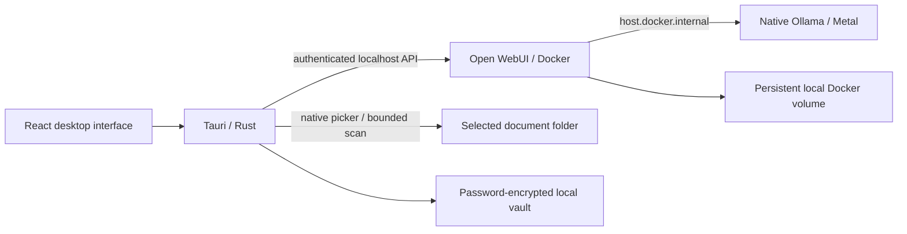

# HERMES-LLM

**Private AI, on your Mac.**

HERMES is a Tauri 2 desktop application that connects native Ollama to a local, authenticated Open WebUI backend. Choose a model, select a document folder, preview incremental changes, and chat with your own knowledge base. No paid AI account is required.

> Development preview · Apple Silicon · app minimum macOS 13+, subject to current Docker/Ollama requirements · ad-hoc signed, not notarized.
> A release is available only after a maintainer runs the release workflow. See [verification status](VERIFICATION.md) for checks actually performed.

<!-- Screenshot placeholder: replace with a captured native Overview window after visual verification. -->
**Screenshot placeholder:** the native Overview contains live service status, model availability and document indexing status. No simulated health or AI replies are used.

## What works

- Guided setup, prerequisite checks and official download links.
- Loopback-only Open WebUI v0.13.5 in Docker, persistent volume, bounded readiness checks, safe stop/restart and local logs.
- Ollama model discovery, selection and explicitly initiated downloads.
- Authenticated streaming chat, cancellation, safe Markdown/code rendering and local desktop conversation history.
- macOS folder picker, PDF/TXT/Markdown filtering, SHA-256 incremental sync, processing status and progress.
- Create/select knowledge bases; preview additions, modifications and deletions; preserve deleted source entries unless explicitly confirmed.
- Native knowledge chat using Open WebUI retrieval, plus a local Open WebUI browser option.
- Persistent preferences, light/dark themes, encrypted local sessions and backend secret.
- CI checks and a macOS `.app`/DMG workflow.

For the scope and remaining manual checks, read [verification](VERIFICATION.md) and [the integration test plan](TESTING.md).

## How it fits together



Desktop conversations are stored in HERMES application data. Open WebUI browser conversations have a separate store; the application does not claim these histories are synchronised.

## Requirements

Install these yourself using their official installers:

- [Ollama for macOS](https://ollama.com/download/mac).
- [Docker Desktop](https://www.docker.com/products/docker-desktop/) with Docker Compose.

Apple Silicon and 16 GB memory are the initial target. Start with a 4B instruct model, such as `qwen3:4b-instruct` (roughly 2.5 GB for the tested quantisation). Larger contexts and models use more unified memory. Docker and document processing also need memory. Allow several GB for the backend image, plus models and your indexed data. Docker Desktop licensing terms apply independently.

## Install a packaged build

1. Download the Apple Silicon DMG from [GitHub Releases](https://github.com/JxmesMaherry/HERMES-LLM/releases) when available.
2. Open the DMG and drag HERMES-LLM into Applications.
3. Launch Docker Desktop and Ollama, then HERMES-LLM.
4. Follow Setup: check services, start the backend, connect a local account, choose a model and select a document folder/knowledge base.
5. Open **Library → Preview changes → Sync now**. Enable **Use knowledge base** in Chat to query it.

The initial builds use ad-hoc signing and are **not Apple-notarized**. Gatekeeper may block launch. After verifying the source, checksum and provenance, use macOS **System Settings → Privacy & Security → Open Anyway** if offered. Do not disable Gatekeeper, remove quarantine attributes or change system security settings to run HERMES.

The app bundles its Compose configuration, not Docker, Ollama or LLM weights. It copies Compose to its own writable application data directory; no source checkout is needed.

## Run from source

Install Node.js 22.12+ (24 recommended), Rust stable with `rustfmt`/`clippy`, and Apple Command Line Tools. These are build dependencies, not packaged-app requirements.

```sh
git clone https://github.com/JxmesMaherry/HERMES-LLM.git
cd HERMES-LLM
npm ci
./scripts/bootstrap.sh
./scripts/doctor.sh
npm run desktop
```

`doctor.sh` exits nonzero while prerequisites or services are unavailable. This is a diagnostic result. Complete setup in the app, or start services from the CLI:

```sh
# Explicit consent for Hugging Face embedding downloads, if the image/cache lacks the model:
./scripts/bootstrap.sh --allow-downloads
./scripts/start.sh
./scripts/logs.sh
./scripts/stop.sh
```

The scripts and app use the same project `hermes-llm`, volume `hermes-llm-open-webui-data`, encrypted credential vault and application configuration. Scripts work from any current directory and preserve existing preferences. `HERMES_CONFIG_DIR` can isolate CLI development configuration, but does not change the production Compose project/volume identity.

`npm run dev` runs only the frontend in a browser. Native commands are deliberately unavailable there; use `npm run desktop` for a functioning application.

## Documents and privacy

Choose a dedicated local folder, rather than an entire home directory. Hidden paths, `.git`, `.env`, `node_modules`, common build/dependency folders and all symlinks are excluded. Text documents must be UTF-8. Default size limit: 20 MB; adjustable up to 50 MB. Scans are bounded at 5,000 documents / 20,000 filesystem entries.

No filesystem watcher runs in this release. Press **Preview changes** and **Sync now** manually. New or changed files are uploaded only to the loopback backend and processed before stale versions are removed. Missing or unreadable folders cause an error. Confirmed removals affect the index/backend copy, never your original documents. Empty knowledge directories are retained for safety. A failed batch retains old indexed versions and lists errors; inspect and retry.

Scanned PDFs may have no extractable text; HERMES does not provide OCR. A successful transport upload alone is not reported as successful indexing. Test retrieval with your own small document before relying on a library.

Cloud model connections, web search, telemetry and automatic version checks are disabled in the supported configuration. Starting the backend can download its official image. Model downloads and optional embedding downloads require user actions. See [security and backup instructions](SECURITY.md).

## Test and build

```sh
npm run lint
npm run typecheck
npm test
npm run build
cargo fmt --manifest-path apps/desktop/src-tauri/Cargo.toml --check
cargo clippy --locked --manifest-path apps/desktop/src-tauri/Cargo.toml --all-targets -- -D warnings
cargo test --locked --manifest-path apps/desktop/src-tauri/Cargo.toml
WEBUI_SECRET_KEY=validation-only docker compose -f infra/docker/compose.yaml config --quiet
npm run dmg
```

The DMG is written under `apps/desktop/src-tauri/target/aarch64-apple-darwin/release/bundle/dmg/`. See [release instructions](RELEASE.md) for artifact verification and tag/manual workflow commands. No Apple Developer account is required for an ad-hoc development build.

## Help and contributing

Read [installation](INSTALLATION.md), [architecture](ARCHITECTURE.md), [development](DEVELOPMENT.md), [troubleshooting](TROUBLESHOOTING.md), and [security](SECURITY.md).

Contributions should include tests for API compatibility, file access, persistence or deletion changes. Keep native operations validated and preserve users’ files and volumes. Describe actual verification in pull requests. Do not commit private documents, credentials, local data or signing material.

## Licences and acknowledgements

HERMES code is [MIT licensed](../LICENSE). This does not relicense dependencies. [Tauri](https://github.com/tauri-apps/tauri), [React](https://github.com/facebook/react), [Ollama](https://github.com/ollama/ollama), and [Open WebUI](https://github.com/open-webui/open-webui) are independent upstream projects. HERMES uses an original interface and preserves Open WebUI’s interface and branding when opening it. Open WebUI has additional branding licence conditions; consult [third-party notices](THIRD-PARTY.md) before redistributing its image or interface.
